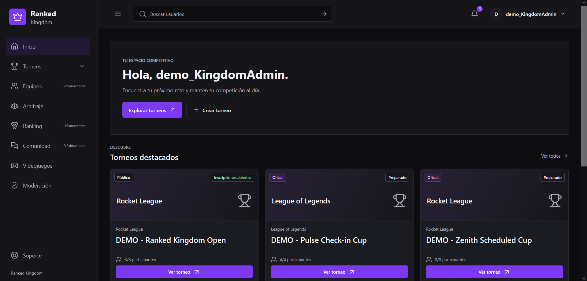
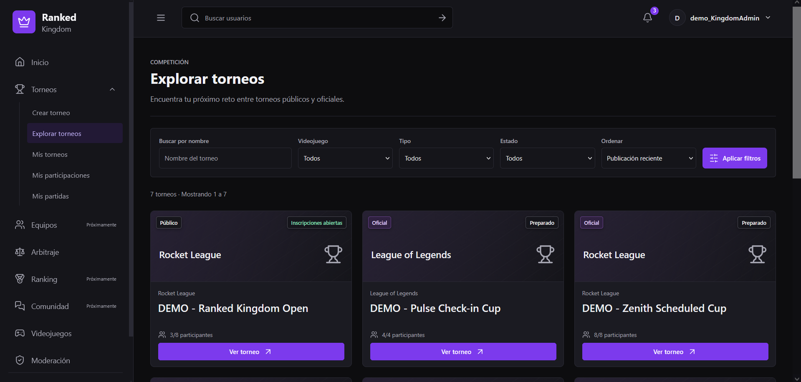
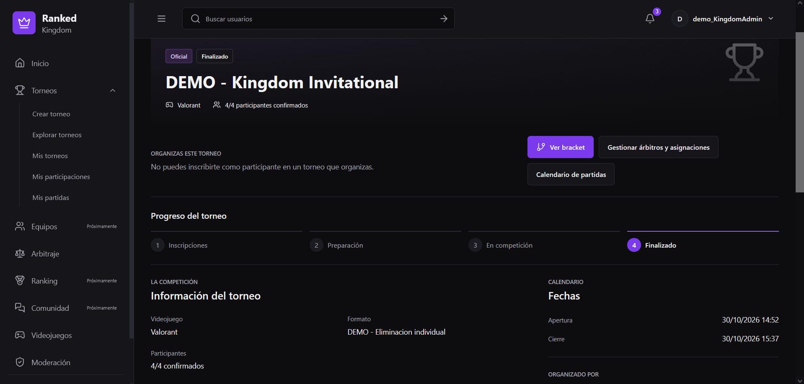
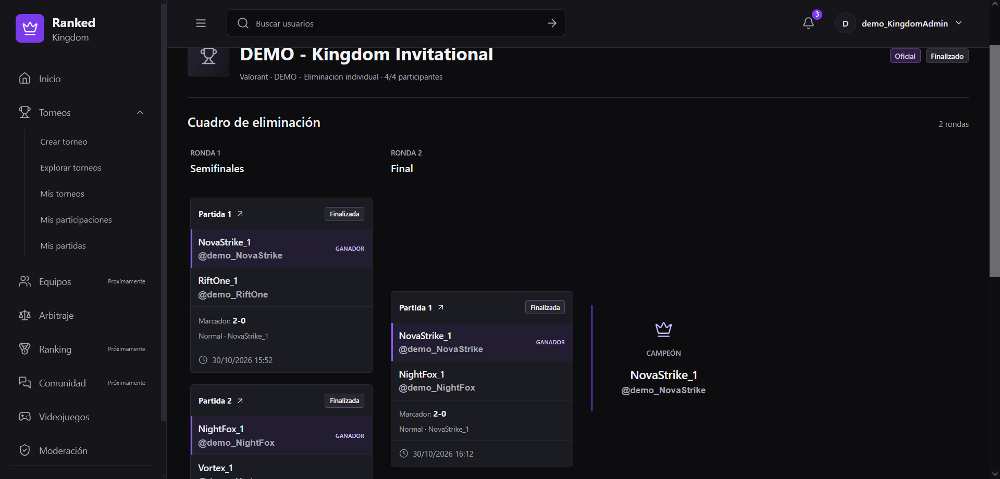
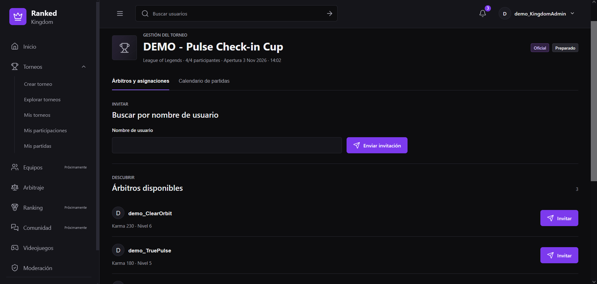
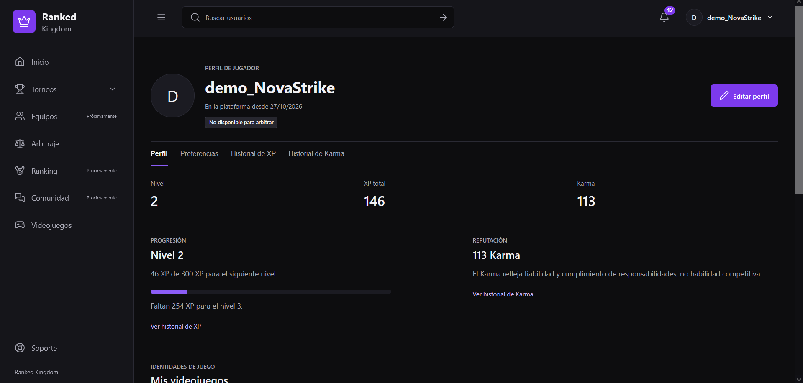
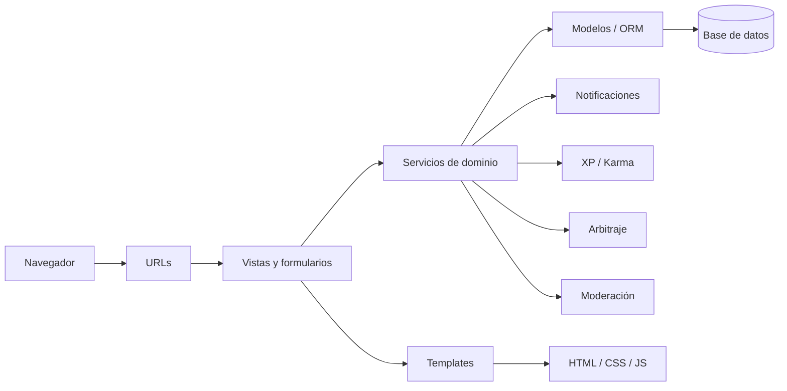

# Ranked Kingdom


**Ranked Kingdom** es una plataforma web para crear, organizar y disputar torneos de videojuegos de forma estructurada.

El proyecto nace con la idea de complementar los sistemas competitivos internos de los videojuegos, ofreciendo una experiencia de torneo accesible tanto a jugadores que quieren competir de forma casual como a quienes buscan construir una trayectoria competitiva más organizada.

El MVP está desarrollado con **Python y Django** y cubre todo el ciclo principal de una competición: creación, inscripción, bracket, partidas, arbitraje, programación, check-in, lobby, resultados, clasificación, progresión, reputación, notificaciones y moderación.

---

## Capturas

### Inicio



### Explorar torneos



### Detalle de torneo



### Bracket



### Arbitraje



### Perfil competitivo



> Las capturas anteriores corresponden al entorno de demostración del proyecto.

---

## Funcionalidades principales

### Torneos

Ranked Kingdom trabaja con tres tipos de competición:

**Privados**
- Acceso mediante enlace privado.
- Pensados para grupos de amigos o competiciones informales.
- Sin impacto en XP ni Karma.
- Sin arbitraje formal obligatorio.
- Sin sistema estricto de check-in.
- Mayor flexibilidad de organización.

**Públicos**
- Creados por usuarios que cumplen los requisitos de progresión y reputación.
- Inscripciones públicas.
- XP y Karma.
- Arbitraje.
- Bracket competitivo.
- Historial de participación.

**Oficiales**
- Gestionados por la administración de Ranked Kingdom.
- Programación formal de partidas.
- Check-in.
- Árbitros.
- Lobby protegido.
- Validación de resultados.
- Clasificación final.
- Preparados para integrar eventos especiales o premios en futuras versiones.

---

## Sistema competitivo

El MVP utiliza torneos individuales de **eliminación directa 1 contra 1**.

El flujo permite:

- inscripción de participantes;
- cierre de plazas;
- preparación de la competición;
- generación del bracket;
- enfrentamientos por rondas;
- programación y reprogramación;
- validación de resultados;
- avance automático;
- campeón;
- clasificación final.

La arquitectura se ha diseñado pensando en incorporar otros formatos en futuras versiones.

---

## Partidas

Cada partida dispone de su propio flujo y puede incluir:

- participantes;
- horario;
- árbitro;
- check-in;
- lobby privado;
- declaración de resultado;
- validación;
- no-show;
- avance dentro del bracket.

La información sensible del lobby solo se muestra a los roles autorizados.

---

## Arbitraje

Los usuarios pueden marcarse como disponibles para arbitrar.

El sistema contempla:

- disponibilidad;
- invitaciones;
- aceptación;
- asignaciones;
- carga arbitral;
- incompatibilidades;
- selección de árbitros disponibles.

Un participante activo de un torneo no puede arbitrar ese mismo torneo.

Los organizadores pueden consultar candidatos disponibles ordenados por Karma y gestionar invitaciones y asignaciones desde la propia competición.

---

## XP y niveles

La experiencia representa la progresión competitiva del usuario.

La curva utilizada es:

```text
XP necesaria = 100 × (nivel - 1)²
```

Por ejemplo:

```text
Nivel 5 = 1600 XP
```

La XP se aplica únicamente a competiciones públicas y oficiales.

---

## Karma

El **Karma** representa la fiabilidad y el comportamiento del usuario dentro de la plataforma.

Puede variar por situaciones como:

- cumplimiento de partidas;
- resultados correctamente comunicados;
- no presentación;
- denuncias confirmadas;
- comportamiento inadecuado;
- información falsa.

Para crear un torneo público se requiere:

```text
Nivel >= 5
Karma >= 150
```

El Karma no representa habilidad competitiva, sino reputación y cumplimiento.

---

## Perfiles competitivos

Cada usuario dispone de un perfil con información como:

- nickname;
- avatar;
- nivel;
- XP;
- Karma;
- historial de XP;
- historial de Karma;
- videojuegos;
- nick competitivo;
- rango;
- plataformas compatibles.

Los datos privados, como el correo electrónico, no forman parte del perfil público.

---

## Videojuegos

La plataforma dispone de un catálogo de videojuegos asociado a:

- plataformas;
- rangos;
- identidades competitivas;
- torneos.

Un mismo usuario puede mantener identidades distintas según el videojuego.

---

## Moderación

El sistema de moderación permite gestionar casos relacionados con:

- conducta antideportiva;
- resultados incorrectos;
- no presentación;
- conflictos entre participantes;
- otras incidencias.

Los administradores pueden revisar, resolver y aplicar medidas conservando el historial del caso.

La información interna de moderación permanece restringida.

---

## Notificaciones

Ranked Kingdom genera avisos para eventos relevantes como:

- invitaciones de arbitraje;
- programación;
- cambios en partidas;
- resultados;
- eventos relacionados con torneos.

Las notificaciones mantienen estado leído/no leído.

---

## Seguridad y privacidad

Entre las medidas implementadas se encuentran:

- permisos por rol;
- protección CSRF;
- separación entre información pública y privada;
- restricciones jugador/árbitro;
- protección del lobby;
- control de estados de cuenta;
- enlaces privados con respuesta neutral;
- validación de acciones;
- conservación de historiales;
- anonimización cuando corresponde.

Los estados de cuenta contemplados son:

- activa;
- suspendida;
- bloqueada;
- eliminada.

---

## Interfaz

La interfaz sigue una identidad visual oscura orientada al entorno competitivo y gaming.

Incluye:

- sidebar para usuarios autenticados;
- navegación pública independiente;
- diseño responsive;
- componentes reutilizables;
- formularios consistentes;
- mensajes globales;
- estados vacíos;
- páginas de error personalizadas.

La interfaz se revisó en:

```text
1440 px
1024 px
768 px
390 px
```

---

## Tecnologías

### Backend

- Python 3.14
- Django 6.1.1
- SQLite en desarrollo

### Frontend

- HTML5
- CSS3
- JavaScript
- Django Templates

### Imágenes

- Pillow 12.3.0

### Desarrollo

- Git
- GitHub
- Visual Studio Code
- GitHub Copilot

---

## Arquitectura

El proyecto sigue una arquitectura Django separando presentación, control, lógica de negocio y persistencia.



La lógica compleja se concentra en servicios y reglas de dominio siempre que es posible, evitando trasladar comportamiento crítico a las plantillas.

---

## Instalación en desarrollo

### 1. Clonar el repositorio

```bash
git clone https://github.com/donvi22/plataforma-torneos-django.git
cd plataforma-torneos-django
```

### 2. Crear el entorno virtual

Windows:

```powershell
python -m venv .venv
.\.venv\Scripts\activate
```

Linux/macOS:

```bash
python3 -m venv .venv
source .venv/bin/activate
```

### 3. Instalar dependencias

```bash
pip install -r requirements.txt
```

### 4. Aplicar migraciones

```bash
python manage.py migrate
```

### 5. Ejecutar el servidor

```bash
python manage.py runserver
```

Por defecto:

```text
http://127.0.0.1:8000/
```

---

## Entorno de demostración

El proyecto incluye un comando específico para generar una base de datos de demo reproducible y aislada de la base de desarrollo habitual.

En PowerShell:

```powershell
$env:TORNEO_DEMO = "1"
.\.venv\Scripts\python.exe manage.py migrate
.\.venv\Scripts\python.exe manage.py seed_demo
.\.venv\Scripts\python.exe manage.py runserver 127.0.0.1:8022 --noreload
```

La demo queda disponible en:

```text
http://127.0.0.1:8022/
```

El comando `seed_demo` es:

- transaccional;
- idempotente;
- protegido para entorno de desarrollo;
- independiente de PKs fijas;
- seguro frente a ejecuciones repetidas.

### Contenido generado

Actualmente prepara:

```text
14 usuarios
8 torneos
34 partidas
6 registros arbitrales
2 denuncias
12 historiales de XP
56 registros de Karma
153 notificaciones generadas por servicios
```

Incluye escenarios de:

- inscripciones abiertas;
- torneo completo;
- torneo en progreso;
- torneo finalizado;
- torneo privado;
- torneo oficial;
- bracket parcial;
- campeón;
- programación;
- reprogramación;
- check-in;
- lobby;
- arbitraje;
- moderación;
- XP;
- Karma.

Las credenciales de demostración se documentan en [`docs/demo.md`](docs/demo.md).

---

## Tests y validación

La validación técnica final del MVP obtuvo:

```text
445 tests ejecutados
445 correctos
0 fallos
0 errores
```

También se comprobó:

```bash
python manage.py check
```

Resultado:

```text
System check identified no issues
```

Migraciones:

```bash
python manage.py makemigrations --check --dry-run
```

Resultado:

```text
No changes detected
```

Además:

- todas las migraciones están aplicadas;
- `pip check` no detecta dependencias rotas;
- 57 templates compilan correctamente;
- 144 referencias de templates fueron verificadas;
- 237 referencias estáticas fueron revisadas;
- `git diff --check` finalizó limpio.

---

## Estado del proyecto

El **MVP de Ranked Kingdom está funcionalmente terminado y validado**.

Áreas completadas:

- autenticación;
- perfiles;
- videojuegos;
- torneos;
- inscripciones;
- torneos privados;
- bracket;
- partidas;
- programación;
- check-in;
- lobby;
- arbitraje;
- resultados;
- XP;
- Karma;
- notificaciones;
- moderación;
- búsqueda;
- experiencia pública;
- experiencia autenticada;
- responsive;
- páginas de error;
- datos de demostración;
- tests automatizados.

La configuración actual sigue siendo de desarrollo.

---

## Preparación para producción

Antes del despliegue público será necesario configurar, entre otros:

- `DEBUG=False`;
- `SECRET_KEY` mediante variable de entorno;
- `ALLOWED_HOSTS`;
- HTTPS;
- cookies seguras;
- `STATIC_ROOT`;
- servicio adecuado para archivos estáticos;
- almacenamiento persistente para archivos multimedia;
- correo real;
- base de datos apropiada para producción;
- estrategia de copias de seguridad.

---

## Roadmap

El roadmap es una guía flexible y puede reorganizarse según usuarios, recursos y oportunidades.

### 1. Torneos por equipos

- equipos persistentes;
- capitán;
- miembros;
- identidad por videojuego;
- inscripción conjunta;
- 5v5 para Valorant, League of Legends y Counter-Strike;
- adaptación para Rocket League.

### 2. Nuevos formatos

- doble eliminación;
- round robin;
- ligas;
- BO3;
- BO5;
- seeds;
- formatos específicos por videojuego;
- battle royale.

### 3. Comunidad

- seguidores;
- amistades;
- mensajería;
- recomendaciones;
- feed;
- equipos y clanes.

### 4. Creadores verificados

Sistema para distinguir organizadores y creadores con trayectoria contrastada dentro de la plataforma.

### 5. Organizaciones y marcas

Integración futura con:

- clubes;
- academias;
- organizaciones esports;
- marcas;
- patrocinadores;
- eventos.

### 6. Ecosistema competitivo

- rankings;
- temporadas;
- circuitos;
- clasificaciones globales;
- torneos conectados;
- eventos clasificatorios.

### 7. Expansión

- aplicación móvil;
- internacionalización;
- infraestructura escalable;
- integración con APIs externas cuando resulte viable.

### 8. Proyección competitiva

A largo plazo, Ranked Kingdom podría actuar como puente entre la competición amateur y entornos competitivos de mayor nivel mediante:

- historial competitivo verificable;
- visibilidad de jugadores;
- clasificatorios;
- invitaciones;
- colaboración con equipos;
- academias;
- organizaciones;
- acceso a eventos externos mediante acuerdos.

El objetivo no es garantizar una carrera profesional, sino proporcionar herramientas para construir una trayectoria competitiva más estructurada.

---

## Visión

**Ranked Kingdom complementa la competición interna de los videojuegos ofreciendo una experiencia de torneo accesible a jugadores que quieren competir de una forma más estructurada.**

El proyecto parte de un MVP individual, pero está planteado para evolucionar hacia equipos, comunidad, nuevos formatos, eventos y un ecosistema competitivo más amplio.

---

## Documentación

La memoria técnica y funcional del proyecto documenta:

- objetivos;
- requisitos;
- arquitectura;
- modelo de datos;
- reglas de negocio;
- funcionalidades;
- pruebas;
- metodología;
- problemas encontrados;
- roadmap;
- conclusiones.

---

## Autor

**Vicent Llopis Molina**

Proyecto final del curso **Programación Python. Certificación PCAP 2.0**  
**Tokio School**

---

## Licencia

Este proyecto no dispone actualmente de una licencia de código abierto.

Todos los derechos sobre el código y el contenido del proyecto quedan reservados a su autor.
